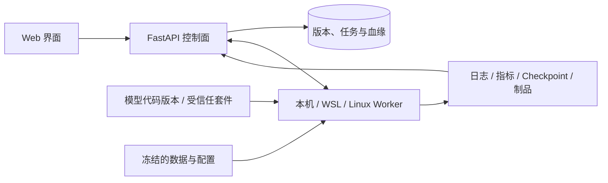

<div align="center">

# ForgeLM

**把数据、代码、训练与产物串成可追踪的工作流。**

A local-first platform for managing LLM workflows.

[](https://github.com/CloudGao/ForgeLM/actions/workflows/ci.yml)
[](LICENSE)
[](pyproject.toml)

[快速开始](#安装与启动) · [架构](#系统架构) · [模型接入](#接入你的模型) · [贡献](CONTRIBUTING.md) · [安全](SECURITY.md)

</div>

---

本地优先的大模型生命周期管理平台。使用 Web 界面、FastAPI 控制面和独立 Worker，管理数据、模型代码版本、Tokenizer、训练实例、Checkpoint、评测、量化、发布与推理请求。

**本仓库发布平台系统。模型结构与训练实现、权重、训练数据和私人实验记录独立管理，不随平台分发。** 平台通过用户代码或受信任插件执行算法，记录实际输入、配置、状态和产物血缘。

## 能力概览

| 环节 | 平台能力 |
|---|---|
| 数据准备 | 导入、预览、转换、清洗、混合，以及数据版本与消费关系追踪 |
| 训练管理 | 冻结代码、数据与配置，通过训练实例和 DAG 调度任务 |
| 运行追踪 | TaskAttempt、日志、指标、Checkpoint、制品与来源关系 |
| 模型应用 | 通过外部运行时接入推理、评测、量化与交付流程 |
| 执行环境 | 本机、WSL 与远程 Linux Worker，SSH 引导及 Agent 隧道 |
| 扩展开发 | 通用命令适配器、插件 SDK 与可安装的 `.flsuite` 套件 |

## 系统架构



控制面负责版本、调度和追踪；Worker 执行实际任务；模型算法由外部代码或插件提供。详见 [技术架构](docs/ARCHITECTURE.md)。

## 适用场景

- 在本机或可信计算环境管理数据和训练流程。
- 冻结代码与数据版本，追踪每次任务的运行、日志、指标和产物。
- 使用 Windows、WSL 或远程 Linux Worker 执行任务。
- 通过通用命令协议或 `.flsuite` 套件接入自己的模型与工具。

当前按可信单用户运行，没有内置登录、角色或项目权限控制。默认只监听回环地址，**不要直接暴露管理 API 到公网**。插件环境不是安全沙箱，详见 [SECURITY.md](SECURITY.md)。

## 安装与启动

需要 Python 3.11+、Node.js 22.12+、pnpm 11.9.0 和 Git。基础控制面不需要 GPU、PyTorch 或模型权重。可选引擎需要另外安装对应依赖并满足硬件条件。

先克隆仓库：

```bash
git clone https://github.com/CloudGao/ForgeLM.git
cd ForgeLM
```

### Windows

PowerShell，在仓库根目录执行：

```powershell
.\scripts\setup.ps1 -SkipDataTools
.\scripts\start.ps1
```

浏览器打开 `http://127.0.0.1:8000`。启动脚本同时运行控制面 Supervisor 和本机 Worker。去掉 `-SkipDataTools` 会额外安装经过哈希校验的 hfd/aria2 下载工具，需要 Git Bash 及相应下载网络。

### Linux / WSL

启动控制面：

```bash
bash scripts/setup-linux.sh
pnpm install --frozen-lockfile
pnpm run build:web
bash scripts/start-control-plane-linux.sh
```

另开终端启动 Worker：

```bash
export LLM_PLATFORM_WORKER_WORKSPACE_ROOT="$PWD/.llm-platform/worker"
bash scripts/start-worker-linux.sh
```

Windows 与 Linux、Python 3.11 / 3.12 的后端测试与打包已在迁移前通过 CI；新仓库的最新状态见页首徽章。CI 不代表真实 GPU 训练或所有远程部署组合已验收，详见 [发布检查](docs/RELEASE_CHECK.md)。

配置项见 [`.env.example`](.env.example)。首次安装使用新的状态目录，不要把开发机器的 `.env`、数据库或私人工作区一起复制给其他用户。默认数据状态位于 `.llm-platform/`；数据库迁移在控制面启动时执行。

## 接入你的模型

1. 在独立 Git 仓库或本地目录维护模型与训练程序。
2. 使用平台的模型代码导入入口，从 Git、本地目录、归档或上传内容创建不可变代码版本。
3. 在 Worker 准备引擎依赖，或导入并安装受信任的 `.flsuite` 套件。
4. 通过训练实例绑定代码版本、数据和配置，提交任务，查看实际状态、日志、Checkpoint 与产物。

模型代码版本负责记录“运行了哪个程序”；Checkpoint 和模型版本记录训练状态及输出，不能相互替代。平台不提供 Git 托管和代码编辑，不会自动安装任意导入代码的依赖。详细说明见 [外部模型与代码版本](docs/developer/external-model-code.md)。

本仓库没有内置 MicroLM 模型实现或专属安装配置。旧格式兼容适配器只能调用另行安装的外部运行时；看到兼容格式名称不代表该模型已包含在平台中。

## 执行环境与可选能力

执行环境页面可管理本机/WSL Worker，以及通过 SSH 引导的远程 Linux Worker。远程预设包含基础、Data-Juicer 数据处理和 Hugging Face 推理；特定模型通过外部代码或套件接入。优先使用默认 SSH Agent 隧道，不需要公开本机管理 API。

可选 Python 依赖组：

| 安装项 | 用途 |
|---|---|
| `.[data-juicer]` | Data-Juicer 清洗运行时 |
| `.[inference-hf]` | Transformers/PyTorch 推理运行时 |
| `.[benchmark-hf]` | lm-evaluation-harness HF 评测 |
| `.[benchmark-vllm]` | lm-evaluation-harness vLLM 评测 |

这些运行时安装在实际执行任务的 Worker 上。安装成功不代表所有模型都兼容；GPU、CUDA、模型许可和运行时支持需按具体模型验证。本次发布没有验证真实 GPU 训练或所有可选依赖组合。

## 开发与测试

```bash
python -m pip install -c constraints.txt -e ".[dev]"
python -m pip check
python -m pytest
pnpm install --frozen-lockfile
pnpm run test:web
pnpm run build:web
```

`constraints.txt` 记录本次基础/开发环境验证的依赖版本，不会安装模型运行时；`pnpm-lock.yaml` 固定 Web 依赖。可选引擎测试在缺少依赖时明确跳过。测试使用独立临时数据库，不能指向生产状态目录。

Windows 开发服务器使用 `.\scripts\dev.ps1`。插件开发从 [text-tools 示例](examples/plugin-suites/text-tools/README.md) 开始。协议示例 `examples/command_engine.py` 用于验证事件与制品契约，不是训练模型。

## 文档与许可

- [产品设计](docs/DESIGN.md)、[技术架构](docs/ARCHITECTURE.md)
- [发布检查](docs/RELEASE_CHECK.md)、[贡献说明](CONTRIBUTING.md)、[安全说明](SECURITY.md)
- 平台源码采用 [Apache License 2.0](LICENSE)，见 [NOTICE](NOTICE)。
- 第三方依赖保持各自许可证，特别是 Paramiko/LGPL 与 elkjs/EPL；详见 [第三方声明](THIRD_PARTY_NOTICES.md)。平台许可不授予外部模型、数据或插件的分发权。
